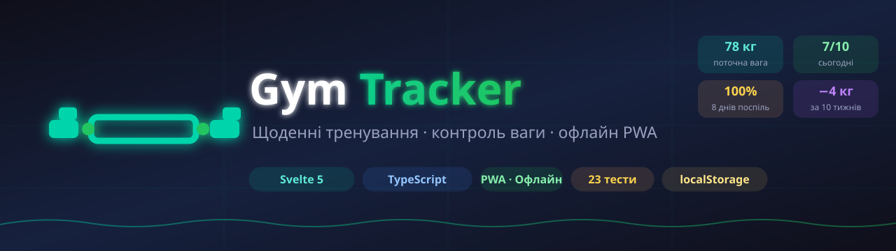
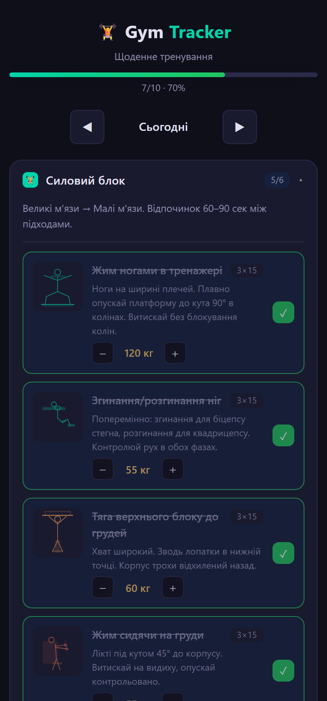
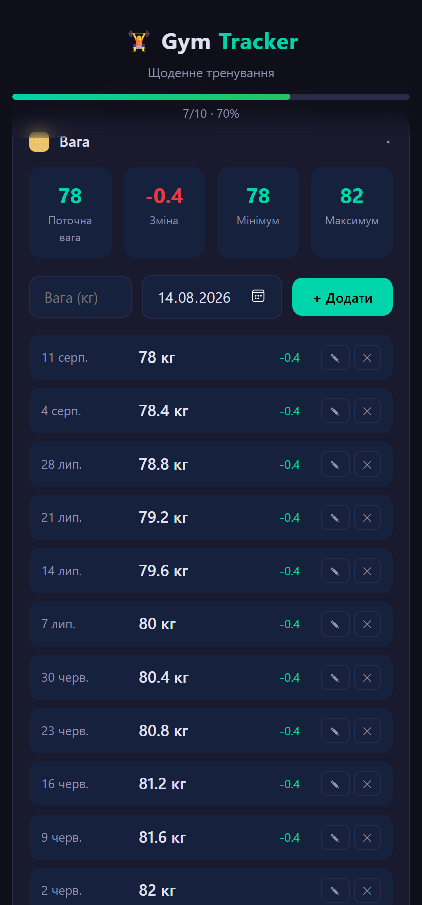
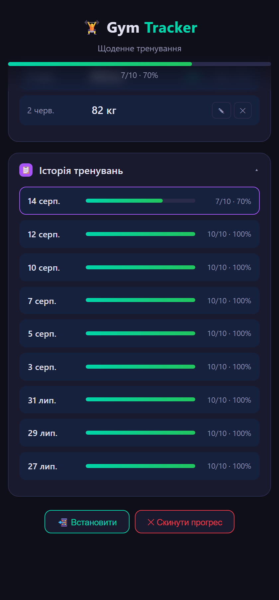

<div align="center">

# Gym Tracker — Source Code

> **Це репозиторій з вихідним кодом Gym workout tracker PWA.**
> Готовий застосунок хоститься з публічного репозиторію артефактів:
> **https://ajjs1ajjs.github.io/dist/gym/**

# Gym Tracker

### Offline-first workout and body progress tracker

<p align="center">
  
</p>

Приватний PWA-застосунок для тренувань у залі. Ведення ваг, плани тренувань та заміри тіла. Працює офлайн і встановлюється на телефон як звичайний застосунок.

<p align="center">
  
  
  
  
  
</p>

[**🌐 Live Site**](https://ajjs1ajjs.github.io/dist/gym/)

</div>
---

## 🖼️ Screenshots

<p align="center">
  
  
  
</p>

---

## ✨ Features

- 💪 19 вправ у 4 блоках: сила, інтенсивний фінішер, кор, кардіо
- ✅ Облік підходів (крапки 3×) і вага кожної вправи з історією («перед цим: 60 кг»)
- ⏱ Таймер відпочинку між підходами (вібрація + сповіщення, +15 с, Wake Lock)
- 📊 Графік ваги (спарклайн) та історія вимірювань зі змінами
- 🗓 Історія тренувань по днях із відсотком виконання
- ↩️ Undo: видалення вимірювання чи скидання прогресу можна скасувати тостом
- 💾 Бекап: експорт/імпорт усіх даних у JSON (з підтримкою старих бекапів)
- 🛡️ Дані зберігаються в браузері на цьому пристрої. Регулярно експортуйте бекап; JSON-файл містить особисті вимірювання — зберігайте його приватно.
- 🔒 Офлайн-режим — застосунок працює без інтернету (PWA)
- 💽 Локальне зберігання даних у `localStorage` з валідацією та карантином пошкоджених даних
- 📱 Встановлення на телефон та планшет як рідний застосунок

## Структура тренувань

| Блок | Фокус |
|------|-------|
| **Силовий блок** | Ноги, тяга, жими, плечі та руки (3×12–15) |
| **Інтенсивний фінішер** | Бурпі (3–4×10), скакалка (3×60с) |
| **Блок для кору** | Прес, підйом ніг, твіст, планка, гіперекстензія (3×12–20) |
| **Кардіо (Заминка)** | Ходьба з нахилом або велотренажер (15–30 хв, пульс 110–130) |

## Технології

- **Svelte 5** — реактивність із мінімальним DOM, без runtime-бібліотек
- **TypeScript** — повна типізація
- **Vite** — швидкий білд, максимальна швидкість
- **vite-plugin-pwa** — автоматичний service worker (precache + cache-first)
- **Vitest** + **@testing-library/svelte** — 95 юніт/компонентних тестів
- **Playwright** — 7 E2E-сценаріїв (PWA-білд у Chromium)
- **Lighthouse CI** — аудит Performance/A11y/Best-practices (ручний воркфлоу **Quality**)
- **ESLint** + **svelte-check** — якість коду

## 🚀 Getting started

Користувачам достатньо відкрити **[живий застосунок](https://ajjs1ajjs.github.io/dist/gym/)** —
він працює офлайн і встановлюється на телефон як PWA.

Для локальної розробки (Node.js 22):

```bash
npm ci             # встановлення залежностей із lockfile
npm run dev        # dev-сервер (Vite, http://localhost:5173)
npm test           # юніт/компонентні тести (Vitest)
npm run test:e2e   # E2E-тести (Playwright; спершу збирає dist/)
npm run test:lighthouse  # Lighthouse-аудит (потрібен встановлений Chrome)
npm run check      # type-check (svelte-check)
npm run lint       # eslint
npm run build      # продакшн-білд у dist/
npm run preview    # перегляд білд-результату
```

## Деплой

Сайт — зібрана PWA в теці `gym/` публічного репо
[`ajjs1ajjs/dist`](https://github.com/ajjs1ajjs/dist), який віддає GitHub Pages:
**https://ajjs1ajjs.github.io/dist/gym/**.

Реліз — **локально**: `.\scripts\Release-Local.ps1 -Bump minor` — скрипт перевіряє,
збирає PWA, дзеркалить білд у `dist/gym/`, створює тег `gym-v<semver>` і бампить версію.
Якщо білд не змінився — ні публікації, ні тега, ні бампа. Ручний fallback:
**Actions → Release → Run workflow**. Автозапусків за розкладом нема (свідомо: релізи
тільки вручну). Звичайні коміти реліз не запускають.

## Посилання

Жива версія: [https://ajjs1ajjs.github.io/dist/gym/](https://ajjs1ajjs.github.io/dist/gym/)

## Історія версій

Див. [CHANGELOG.md](CHANGELOG.md).
